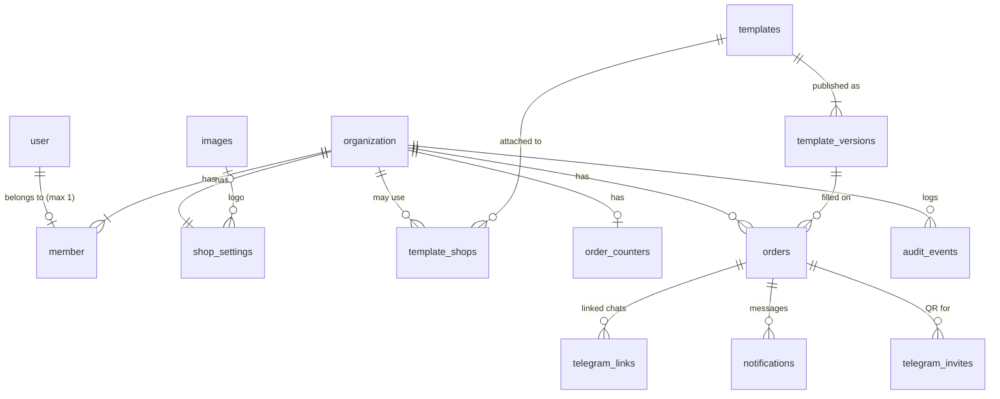

# Data model

← [Docs](../README.md) · Query rules: [repositories.md](./repositories.md) · Writes: [architecture → Writing data](./architecture.md#writing-data)

Every table, its owner, its constraints and its lifecycle. When a migration changes a table, this page changes in the same PR.

**Status:** the migrations restarted from `0000` in plan step 1 ([D31](../decisions.md#d31-the-slip-studio-a-template-is-the-paper-slip): only test data existed). Every table below is built by `0000_init`, plus `0001_member_one_shop`. Each table's **Status** says which step builds the code that uses it.

---

## Conventions

- Tables `snake_case` plural; columns `snake_case` in SQL, `camelCase` in TypeScript (Drizzle `casing: 'snake_case'`).
- Our ids: UUID v7 (`text` primary key). Better Auth tables keep their own ids. Where a natural key is the identity, it's the key: an outbox row (its dedupe key), a QR token's hash, a shop's attachment of a template (`shop_id`, `template_id`).
- **Every shop-owned table has `shop_id`** (FK → `organization.id`, **restrict**), and every query filters by it. **Platform tables** (`templates`, `template_versions`, `images`) have none: only the platform reads them, and a shop reaches a template only through `template_shops` or its own order.
- Shared column builders (`shopId`, `createdBy`, `timestamp`, `nowMs`, `inList`) are in `server/db/columns.ts`, so two schemas can reference each other's tables without a circular import.
- Money: integer minor units, with the currency beside it. Times: UTC (`integer` timestamp_ms). A shop's day: `YYYY-MM-DD` text in the shop's time zone.
- Enum columns: lower `snake_case` text with a `CHECK`. JSON columns: a `CHECK (json_valid(…))`; their shape is checked by a Valibot schema on every write and they're read whole, never queried inside.
- Editable records have `version` (integer, starts at 1).
- **FK on-delete:** as listed per table; otherwise **restrict**. Parents (shops, templates, versions, orders) are never deleted, so restrict only turns a bug into an error.

## Relationships

## Better Auth tables (owner: `identity`)

**Status:** built. Generated by `@nuxtjs/better-auth` from `identity.auth.ts`.

| Table | Notes |
|---|---|
| `user` | Plus `username` UNIQUE, `display_username` (username plugin), `role` (admin plugin: `user` or `superadmin`), `banned`, `ban_reason`, `ban_expires`, `must_change_password` (additional field). `email` holds `<id>@users.invalid` ([D15](../decisions.md#d15-accounts-username-and-a-placeholder-email)) |
| `session`, `account`, `verification` | Better Auth's |
| `organization` | = a shop: `id`, `name`, `slug`, `createdAt` |
| `member` | `organizationId`, `userId` **UNIQUE** (`member_user_id_unique`, our migration `0001`, [D17](../decisions.md#d17-one-shop-per-user-in-the-database)), `role` (`owner` \| `staff`). Better Auth's FKs cascade on user/organization delete; neither is ever deleted |
| `rate_limit` | Better Auth's rate-limit counters (`storage: 'database'`), also our per-username sign-in count ([D18](../decisions.md#d18-sign-in-limits)) |
| `invitation` | Exists, unused; its endpoints are blocked |

## `shop_settings` (owner: `shops`)

**Status:** built and used. Created with the shop by the platform (version 1, `active`); suspend, resume, the platform's rename and the owner's settings save all move `version`.

| Column | Type | Notes |
|---|---|---|
| `shop_id` | text PK | FK → `organization.id`, restrict |
| `phone` | text null | As the shop writes it |
| `address` | text null | |
| `logo_image_id` | text null | FK → `images.id`, restrict. Unused since D35 (the artwork carries the shop's look); kept for the order's copy of the shop's details |
| `currency` | text | `KHR` (default) \| `USD`. May change at any time: each order keeps a copy ([D33](../decisions.md#d33-studio-scope-photo-first-english-only-shop-details-copied-to-the-order)) |
| `language` | text, default `en` | **Unused since D36** (English only); dropped by a later migration |
| `status` | text | `active` \| `suspended` |
| `version`, `created_at`, `updated_at` | | |

## `templates`, `template_versions`, `template_shops`, `images` (owner: `templates`)

**Status:** tables built in step 1. S1 built the templates' and images' code: create (from an artwork or a copy; blank and photo before D35), the draft's autosave at its version, publish, preview, image upload ([reference/slip.md](../reference/slip.md) for the design). Step 2 built attachments (attach a published template to a shop, detach) and archive / restore: archiving detaches the template from every shop in the same batch.

`templates` (platform): `id`, `name`, `status` (`draft` \| `published` \| `archived`), `design` (JSON: the draft being edited, checked by `designSchema` on every write, ≤ 256 KB), `version`, `created_by` (→ `user.id`), timestamps.
- UNIQUE `lower(name)`: the platform finds a template by name. Index `(status, updated_at)`.
- **Archived, never deleted.** Its versions and the orders made on them stay.

`template_versions` (platform): `id`, `template_id` (FK restrict), `number` (≥ 1), `design` (JSON), `created_by`, `created_at`. **Never changes.**
- Each Publish copies the draft into a new row (number + 1). UNIQUE `(template_id, number)`, which is also the "latest version" lookup: there's no "latest" column to fall out of step.
- An order keeps the version it was made on (plan §4), so a version with orders can't be deleted (restrict).

`template_shops` (shop-owned): `shop_id`, `template_id` (FK restrict), `is_default` (bool), `attached_at`. PK `(shop_id, template_id)`.
- Which templates a shop may use. **The default is a flag here, not a column on `shop_settings`**: partial UNIQUE `(shop_id)` where `is_default`, so a shop has at most one default and it is always an attached template. Detaching it (deleting the row) leaves the shop with no default; the owner chooses again (plan §4).
- Index `(template_id)`: the shops a template is attached to.

`images` (platform): `id`, `name`, `type` (`image/png` \| `image/jpeg`), `width`, `height` (200–2000 each), `size` (bytes, 1 B–1 MB), `data` (**base64 text**), `created_by`, `created_at`. Index `(created_at)`.
- Slip backgrounds, pictures on a slip, shop logos, shared by every template (plan §5.9). The type and size are read from the file's bytes, never from the request (D28).
- Base64 text, not a BLOB: D1 returns a BLOB as an array of numbers, and the SVG wants base64 anyway. 1 MB of image is 1.34 MB of text, under D1's 2 MB row limit. **Every query leaves `data` out** but the ones that draw or serve the image.

## `order_counters`, `orders` (owner: `orders`)

**Status:** tables built in step 1. The counter ([D37](../decisions.md#d37-the-owners-counter-new-order-preview-save-once-reprint)) built create (`Idempotency-Key`), read and the newest-first list; D38 the search, Mark paid (`Idempotency-Key`), Picked up and Cancel, each at its `version` and guarded in SQL by the state it starts from (`orders.rules.ts → canDo`).

`order_counters`: `shop_id` PK, `last_number` (≥ 0). Raised (an upsert: the first order makes the row) in the same batch as the order insert, which reads it back for `number`. Two shops count on their own: the same number in two shops is two orders.

`orders`: a filled slip ([D31](../decisions.md#d31-the-slip-studio-a-template-is-the-paper-slip)).

| Column | Type | Notes |
|---|---|---|
| `id`, `shop_id` | | |
| `number` | integer | Per shop, set by the server. UNIQUE `(shop_id, number)` |
| `date` | text | The shop's day the order was made (`YYYY-MM-DD`), set by the server. CHECK on the format |
| `template_version_id` | text | FK → `template_versions.id`, restrict. The version the owner filled, accepted only while it is the latest of a template attached to the shop (guarded in the order's batch); the order keeps it forever, so a reprint draws the same slip |
| `values` | JSON | The owner's values by element id, checked by the server against the template version |
| `shop` | JSON | **A copy of the shop's details when the order was saved**: name, phone, address, logo image id, currency, language ([D33](../decisions.md#d33-studio-scope-photo-first-english-only-shop-details-copied-to-the-order)). The slip is drawn from it, so it never changes |
| `phone` | text null | E.164, from the slip's Phone field |
| `amount` | integer null | Minor units of the copy's currency, as the owner typed it; `null` when the slip has no Amount |
| `paid` | bool | Default false |
| `status` | text | `open` \| `picked_up` \| `cancelled` |
| `paid_at`, `picked_up_at`, `cancelled_at` | timestamp null | CHECKs: each is set exactly when its state is (`paid`, `picked_up`, `cancelled`) |
| `version`, `created_by`, `created_at`, `updated_at` | | `created_by` → `user.id` |

- Indexes: `(shop_id, date, created_at)` Overview's today; `(shop_id, created_at)` the list; `(shop_id, phone)` the Orders search by phone (migration `0002`). The search by number uses UNIQUE `(shop_id, number)`. UNIQUE `(shop_id, id)`: the target of the Telegram tables' composite FKs.
- CHECKs on `status`, `number >= 1`, `amount >= 0`, the date's format, `json_valid` of `values` and `shop`.
- **Never deleted.** Cancelled (plan §4).

## `telegram_links`, `notifications` (owner: `notifications`)

**Status:** tables and the outbox code (deliver, retry, purge) built; step 4 queues the messages and runs the delivery job.

`telegram_links`: `id`, `shop_id`, `order_id` (composite FK `(shop_id, order_id)` → the shop's order, **cascade**), `telegram_user_id`, `chat_id` (Telegram's ids as text: up to 52 bits, only compared), `linked_at`, `revoked_at`.
- **One order per link** (plan §8). Partial UNIQUE `(shop_id, order_id, telegram_user_id)` where live: a second scan keeps the one link (insert or nothing). Index `(chat_id)`.
- **Revoked, never deleted,** when Telegram says the person blocked the bot (every link to that chat, in every shop).

`notifications` (the outbox, spec §8.3): `id` (**the dedupe key**: `slip:<order>:<chat>`), `shop_id`, `order_id` (composite FK, **cascade**), `chat_id`, `kind` (`slip`), `status` (`pending` \| `sent` \| `skipped` \| `failed`), `attempts`, `last_error`, `next_attempt_at`, `created_at`, `sent_at`.
- Queued in the batch of the change it tells about.
- A sender **claims** a row before sending (`attempts` + 1, hidden for a 5-minute lease), so overlapping runs never send the same row at once. At least once: a sender that dies mid-send leaves it to be sent again. Backoff 1, 5, 15, 60 minutes, or the channel's own wait; failed after 5 attempts.
- Index `(status, next_attempt_at)` for the delivery job's scan across shops; `(shop_id, order_id)` for an order's messages.
- Sent, skipped and failed rows purged after 90 days.

(The cascades are a safety net only: orders are never deleted.)

## `telegram_invites` (owner: `telegram`)

**Status:** table and its purge built; step 4 makes the QR codes.

`telegram_invites`: `token_hash` (SHA-256 of the QR's token) PK, `shop_id`, `order_id` (composite FK, **cascade**), `expires_at`, `created_at`. Only the hash is stored: a database read can't make a working QR. Purged daily once expired (`notifications:purge`).

The phone check's table (`telegram_pending`) comes back in step 4 only if the owner keeps the check (plan Q11).

## `audit_events`, `idempotency_keys` (owner: `platform`)

**Status:** built and used.

`audit_events` (append-only; written only through `auditStatement`, in the batch of the change):

| Column | Type | Notes |
|---|---|---|
| `id` | text PK | UUID v7 |
| `shop_id` | text null | FK → `organization.id`, restrict. The shop the action happened **in**; `null` for a platform action, whose shop is the target ([D19](../decisions.md#d19-platform-actions-and-their-audit-rows)) |
| `actor_user_id` | text | Plain text, no FK: the trail outlives account changes |
| `action` | text | `resource.verb`: `shop.create`, `shop.update`, `shop.suspend`, `shop.resume`, `shop.settings.update`, `owner.reset-password`, `owner.revoke-sessions`, `template.create`, `template.rename`, `template.publish`, `template.archive`, `template.restore`, `template.attach`, `template.detach` (with the shop's id in `data`), `image.upload`. A template's draft autosave (about once a second while editing) writes none: a draft reaches no shop until it's published |
| `target_type`, `target_id` | text | `shop` + the shop's id |
| `data` | json null | Which fields changed, ids; never passwords or personal values |
| `request_id` | text null | Leads to the request's log lines |
| `created_at` | ms timestamp | |

Indexes: `(shop_id, created_at)` a shop's or the platform's history; `(target_type, target_id, created_at)` one record's history.

`idempotency_keys`: `shop_id` (FK → `organization.id`, restrict), `actor_user_id`, `action`, `key`, `request_hash` (SHA-256 of the validated request), `response` (json: `{ id }` of the record made or changed), `created_at`. PK `(shop_id, actor_user_id, action, key)`; index `(created_at)` for the purge. Purged after 24 h (`platform:expire-idempotency-keys`). Used by order create and mark paid (step 3). API: [reference/idempotency.md](../reference/idempotency.md).

## Lifecycle summary

| Record | Rule |
|---|---|
| Shop | Never deleted. Suspended |
| Owner user | Never deleted while the shop exists. Banned / password reset |
| Template | Archived, never deleted |
| Template version | Never changes, never deleted |
| Template attachment | Deleted when detached (the default goes with it) |
| Image | Never deleted while a template version, a shop or a draft uses it |
| Order | Never deleted. Cancelled |
| Telegram link | Revoked (bot blocked); never deleted |
| Notifications | Sent, skipped and failed rows purged after 90 days |
| Telegram invites | Purged once expired |
| Idempotency keys | Purged after 24 h |
