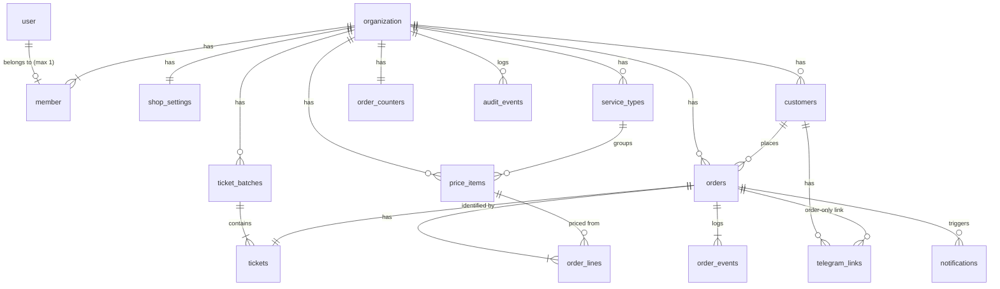

# Data model

← [Docs](../README.md) · Query rules: [repositories.md](./repositories.md) · Writes: [architecture → Writing data](./architecture.md#writing-data)

Every table, its owner, its constraints and its lifecycle. This is spec §6, kept current: when a migration changes a table, this page changes in the same PR.

**Status:** each table's **Status** says the migration that built it, or the step that will.

---

## Conventions

- Tables `snake_case` plural; columns `snake_case` in SQL, `camelCase` in TypeScript (Drizzle `casing: 'snake_case'`).
- Our ids: UUID v7 (`text` primary key). Better Auth tables keep their own ids.
- **Every table below except Better Auth's has `shop_id`** (FK → `organization.id`, **restrict**), and every query filters by it.
- Money: integer minor units with a currency code beside it. Weight: integer grams. Times: UTC (`integer` timestamp_ms).
- Enum columns: lower `snake_case` text with a `CHECK`.
- Editable records have `version` (integer, starts at 1).
- **FK on-delete:** as listed per table. Where the spec gives none, the FK is **restrict**: the parent (shop, customer, order) is never deleted, so restrict only turns a bug into an error.

## Relationships

## Better Auth tables (owner: `identity`)

**Status:** Built (migrations `0000_identity`, `0001_member_one_shop`). Generated by `@nuxtjs/better-auth` from `identity.auth.ts`.

| Table | Notes |
|---|---|
| `user` | Plus `username` UNIQUE, `display_username` (username plugin), `role` (admin plugin: `user` or `superadmin`), `banned`, `ban_reason`, `ban_expires`, `must_change_password` (additional field). `email` holds `<id>@users.invalid` ([D15](../decisions.md#d15-accounts-username-and-a-placeholder-email)) |
| `session`, `account`, `verification` | Better Auth's |
| `organization` | = a shop: `id`, `name`, `slug`, `createdAt` |
| `member` | `organizationId`, `userId` **UNIQUE** (`member_user_id_unique`, our migration `0001`, [D17](../decisions.md#d17-one-shop-per-user-in-the-database)), `role` (`owner` \| `staff`). Better Auth's FKs cascade on user/organization delete; neither is ever deleted |
| `rate_limit` | Better Auth's rate-limit counters (`storage: 'database'`), also our per-username sign-in count ([D18](../decisions.md#d18-sign-in-limits)) |
| `invitation` | Exists, unused; its endpoints are blocked |

## `shop_settings` (owner: `shops`)

**Status:** Built (migration `0000_identity`). Created with the shop by the platform (M1.5, version 1, `active`); suspend, resume, the platform's rename and the owner's settings save (`/api/shop/settings`, M2.1) all move `version`. **The currency changes only while the shop has no price item**, archived included, checked inside the save's batch (D22).

| Column | Type | Notes |
|---|---|---|
| `shop_id` | text PK | FK → `organization.id`, restrict |
| `phone` | text null | |
| `address` | text null | |
| `currency` | text | `KHR` (default) \| `USD`. One currency per shop (P7) |
| `policy_text_km`, `policy_text_en` | text null | Shown on the public ticket page |
| `reminder_after_days` | integer | Default 3 (P13) |
| `language` | text | `en` (default) \| `km`: customer-facing messages and the ticket page. Not in spec §6; spec §3 lists it as a shop setting ([D6](../decisions.md#d6-shop-language-column)) |
| `status` | text | `active` \| `suspended` |
| `version`, `created_at`, `updated_at` | | |

## `customers` (owner: `customers`)

**Status:** M2.2.

| Column | Type | Notes |
|---|---|---|
| `id`, `shop_id` | | |
| `name` | text | Cleared on anonymize |
| `phone_e164` | text null | Normalized on the server (`libphonenumber-js`, region KH). Cleared on anonymize |
| `note` | text null | |
| `anonymized_at` | timestamp null | |
| `version`, `created_at`, `updated_at` | | |

- Partial UNIQUE `(shop_id, phone_e164)` where `phone_e164` is not null. A duplicate → `409`, and the UI offers the existing customer.
- **Never deleted.** Anonymized (P11): the phone is freed for reuse.

## `service_types`, `price_items` (owner: `pricing`)

**Status:** Built (migration `0003_pricing`, M2.1).

`service_types`: `id`, `shop_id`, `name_en`, `name_km` null, `sort`, `status` (`active` \| `archived`), `version`, timestamps.
- UNIQUE `(shop_id, id)`: the target of `price_items`' composite foreign key. Index `(shop_id, status, sort)`.

`price_items`: `id`, `shop_id`, `service_type_id`, `name_en`, `name_km` null, `unit` (`piece` \| `kg`), `price` (integer ≥ 0, minor units of the shop's currency, per piece or per kg), `sort`, `status`, `version`, timestamps.
- **FK `(shop_id, service_type_id)` → `service_types (shop_id, id)`, restrict**: an item's service type is always its own shop's, whatever writes it ([D22](../decisions.md#d22-the-price-list)). Indexes `(shop_id, status, sort)`, `(shop_id, service_type_id)`.
- CHECKs on `status`, `unit`, `price >= 0`.

Rules (service, inside the batch):
- **Archived, never deleted.** Archived entries aren't offered for new orders; orders keep their own copy of names and prices (M2.3). No restore yet.
- A service type is archived only with **no active items**; an item goes only into an **active** service type.
- At most **50 active service types and 300 active items per shop**, so a list is always read whole (D22).
- New entries go last (`sort` = the shop's max + 1, computed in the insert).
- `name_en` required, `name_km` optional ([D4](../decisions.md#d4-english-is-the-default-language)).
- Every write has an `audit_events` row in the shop's history (`service-type.*`, `price-item.*`; `data.fields` on edits).

## `order_counters`, `orders`, `order_lines`, `order_events` (owner: `orders`)

**Status:** M2.3.

`order_counters`: `shop_id` PK, `last_number`. Incremented in the same batch as the order insert.

`orders`:

| Column | Type | Notes |
|---|---|---|
| `id`, `shop_id` | | |
| `number` | integer | Per shop. UNIQUE `(shop_id, number)` |
| `customer_id` | text | FK → `customers`, restrict |
| `status` | text | `received` \| `in_progress` \| `ready` \| `collected` \| `cancelled` |
| `payment_status` | text | `unpaid` \| `paid` |
| `total` | integer | Minor units, computed by the server |
| `currency` | text | Copied from the shop at creation |
| `note` | text null | |
| `ready_at`, `collected_at`, `paid_at`, `cancelled_at` | timestamp null | |
| `version`, `created_by`, `created_at`, `updated_at` | | `created_by` → `user.id` |

- Index `(shop_id, status, created_at)`.
- **Never deleted.** Cancelled.

`order_lines`: `id`, `shop_id`, `order_id` (FK **cascade**), `price_item_id` (FK **set null**), `service_name_km`, `service_name_en`, `item_name_km`, `item_name_en`, `unit`, `quantity` (pieces or grams), `unit_price`, `line_total`, `sort`.
- Names and price are **snapshots**: a later price change never changes old orders.

`order_events`: `id`, `shop_id`, `order_id` (FK cascade), `type` (`created` \| `updated` \| `started` \| `ready` \| `rework` \| `collected` \| `cancelled` \| `payment_recorded` \| `ticket_bound`), `actor_user_id`, `data` (json), `created_at`.

(The cascades are a safety net only: orders are never deleted.)

## `ticket_batches`, `tickets` (owner: `tickets`)

**Status:** M3.1.

`ticket_batches`: `id`, `shop_id`, `count`, `created_by`, `created_at`.

`tickets`:

| Column | Type | Notes |
|---|---|---|
| `id`, `shop_id` | | |
| `batch_id` | text null | FK → `ticket_batches` |
| `serial` | integer | Per shop (manual entry fallback for scanning) |
| `public_token` | text | **UNIQUE**. 128-bit random, base64url, 22 chars |
| `order_id` | text null | **UNIQUE**. Set when bound |
| `bound_at`, `voided_at` | timestamp null | |

- A pre-printed slip is a ticket with no order yet. An order created without a slip gets a ticket generated in the same batch.
- Every lookup goes **token → ticket → order**.
- **Never deleted.** Voided if lost before binding.

## `telegram_links`, `notifications` (owner: `notifications`)

**Status:** M4.1 / M4.2.

`telegram_links`: `id`, `shop_id`, `customer_id` (FK **cascade**), `order_id` null (order-only link), `telegram_user_id`, `chat_id`, `verified_phone` (bool), `linked_at`, `revoked_at`.
- Partial UNIQUE `(shop_id, customer_id, telegram_user_id)` where `revoked_at` is null and `order_id` is null.

`notifications` (the outbox): `id`, `shop_id`, `order_id`, `customer_id`, `chat_id`, `kind` (`order_ready` \| `order_collected` \| `reminder` \| `link_confirmed`), `dedupe_key` **UNIQUE**, `status` (`pending` \| `sent` \| `failed` \| `skipped`), `attempts`, `last_error`, `next_attempt_at`, `created_at`, `sent_at`.
- Sent and skipped rows purged after 90 days.

## `audit_events`, `idempotency_keys` (owner: `platform`)

**Status:** `audit_events` built (migration `0002_audit_events`, M1.5); `idempotency_keys` with its first user, M2.3 (order create) ([D12](../decisions.md#d12-tables-arrive-with-their-first-user)).

`audit_events` (append-only; written only through `auditStatement`, in the batch of the change):

| Column | Type | Notes |
|---|---|---|
| `id` | text PK | UUID v7 |
| `shop_id` | text null | FK → `organization.id`, restrict. The shop the action happened **in**; `null` for a platform action, whose shop is the target ([D19](../decisions.md#d19-platform-actions-and-their-audit-rows)) |
| `actor_user_id` | text | Plain text, no FK: the trail outlives account changes |
| `action` | text | `resource.verb`: `shop.create`, `shop.update`, `shop.suspend`, `shop.resume`, `owner.reset-password`, `owner.revoke-sessions` |
| `target_type`, `target_id` | text | `shop` + the shop's id |
| `data` | json null | Which fields changed, ids; never passwords or personal values |
| `request_id` | text null | Leads to the request's log lines (not in the spec's list; added for support) |
| `created_at` | ms timestamp | |

Indexes: `(shop_id, created_at)` a shop's or the platform's history; `(target_type, target_id, created_at)` one record's history.

`idempotency_keys`: `key`, `shop_id`, `actor_user_id`, `action`, `request_hash`, `response` (json), `created_at`. Unique on the scope + key. Purged after 24 h.

## Lifecycle summary

| Record | Rule |
|---|---|
| Shop | Never deleted. Suspended |
| Owner user | Never deleted while the shop exists. Banned / password reset |
| Customer | Never deleted. Anonymized |
| Service type, price item | Archived. Line FK is `set null` as a safety net |
| Order | Never deleted. Cancelled |
| Ticket | Never deleted. Voided if lost before binding |
| Notifications | Sent/skipped rows purged after 90 days |
| Idempotency keys | Purged after 24 h |
